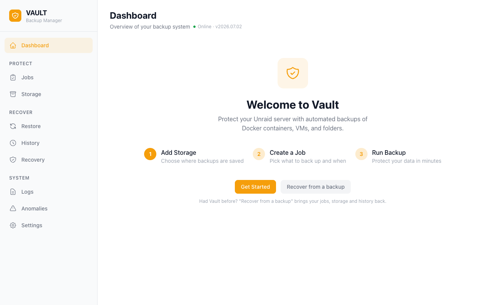

# Vault

[](https://github.com/tinkerologie/vault/actions/workflows/ci.yml)
[](https://github.com/tinkerologie/vault/releases/latest)
[](https://go.dev/)
[](https://svelte.dev/)
[](https://codecov.io/gh/tinkerologie/vault)

[](https://github.com/tinkerologie/vault/blob/main/LICENSE)

Vault is a backup and restore daemon for [Unraid](https://unraid.net/) servers.
It backs up Docker containers, libvirt VMs, ZFS datasets, folders, and plugins.
It supports local disk, SFTP, SMB, NFS, WebDAV, and S3-compatible storage.

Vault includes a Svelte 5 web UI, a REST API, and an MCP server.
It sends progress updates over WebSocket.



## Features

**Backup sources**

- Docker container images, XML templates, and included volumes. You can exclude paths for each container.
- libvirt VMs in live snapshot or cold mode, with NVRAM.
- ZFS datasets with native `zfs send` and `zfs receive`.
- Folders on the host and installed Unraid plugins.
- Status for items that Vault cannot find on the host.

**Storage destinations**

- Local disk, SFTP, SMB, NFS, WebDAV, and S3-compatible storage.
- Bandwidth limits for each remote destination.
- Connection and storage health tests.
- Import of backups from other Vault servers or AppData Backup.

**Backup options**

- Full, incremental, and differential backups.
- Simple count retention or Long-Term Retention (LTR).
- Password-based encryption with age.
- Content-defined deduplication with a repository for each destination. Use `vault dedup gc` and `vault dedup repair` for maintenance.
- SHA-256 verification after a backup and on-demand verification of restore points.
- Discord notifications for backup success or failure.

**Scheduling**

- Cron schedules and presets for hourly, daily, weekly, monthly, and yearly backups.
- First-day and last-day schedules for each month.
- Vault cancels a backup after approximately two hours without data transfer. A backup that continues to transfer data has no fixed time limit.

**Web UI**

- Dashboard, Jobs, Storage, Replication, Restore, History, Disaster Recovery, Logs, and Settings.
- Backup progress and queue status.
- Light and dark themes and a layout for small screens.
- Recovery instructions for a replacement server.

**Integration and diagnostics**

- REST API at `/api/v1`. Remote clients need an API key.
- MCP server over Streamable HTTP. A stdio bridge can connect Claude Desktop and other clients.
- Home Assistant integration ([ha-vault](https://github.com/tinkerologie/ha-vault)).
- SQLite database recovery from a persistent snapshot or USB shadow after reboot.
- Diagnostics download with credential values removed.

## Installation

### Unraid Community Applications

Search for **Vault** in Unraid Community Applications. Click **Install**.

### Manual Install

1. In the Unraid web UI, open **Plugins** → **Install Plugin**.
2. Paste this URL.

   ```text
   https://raw.githubusercontent.com/tinkerologie/vault/main/plugin/vault.plg
   ```

3. Click **Install**.

## Quick Start

1. Open **Storage**.
2. Add a storage destination.
3. Open **Jobs**.
4. Click **Create Job**.
5. Select the items to back up.
6. Set the schedule.
7. Set the retention options.
8. Save the job.
9. Click **Run Now** to start the job immediately.
10. Open **History** to see the result.

## Documentation

| Document                                                    | Description                                           |
| ----------------------------------------------------------- | ----------------------------------------------------- |
| [Getting Started](docs/getting-started.md)                  | Visual walkthrough of the web UI with screenshots     |
| [Backup Jobs](docs/guides/backup-jobs.md)                   | Job options, scheduling, retention, restore           |
| [Storage Destinations](docs/guides/storage-destinations.md) | Per-backend configuration with provider notes         |
| [Anomaly Detection](docs/guides/anomaly-detection.md)       | Drift/reliability/capacity alerts + baseline learning |
| [API Reference](docs/api.md)                                | Full REST API endpoint reference                      |
| [MCP Integration](docs/mcp.md)                              | Model Context Protocol server for AI tools            |
| [Architecture](docs/architecture.md)                        | Project structure, build commands, deployment         |
| [Contributing](CONTRIBUTING.md)                             | Contribution guidelines and development setup         |
| [Changelog](CHANGELOG.md)                                   | Release notes by version                              |

Home Assistant users: use the ready-to-use custom integration at
[ha-vault](https://github.com/tinkerologie/ha-vault).

## Requirements

- Unraid 7.0 or newer

## Support and Feedback

- Bug reports: [open a bug report](https://github.com/tinkerologie/vault/issues/new?template=01-bug-report.yml)
- Enhancement requests: [request an improvement](https://github.com/tinkerologie/vault/issues/new?template=02-enhancement-request.yml)
- Questions and support: [use the Unraid forum support thread](https://forums.unraid.net/topic/197786-plugin-vault-backup-manager)

## License

Vault is licensed under the [GNU Affero General Public License v3.0](LICENSE). It is a third-party
community plugin for Unraid OS.
