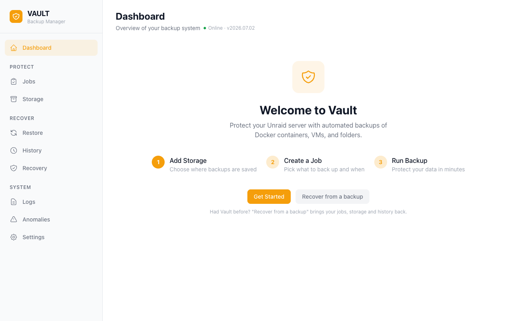
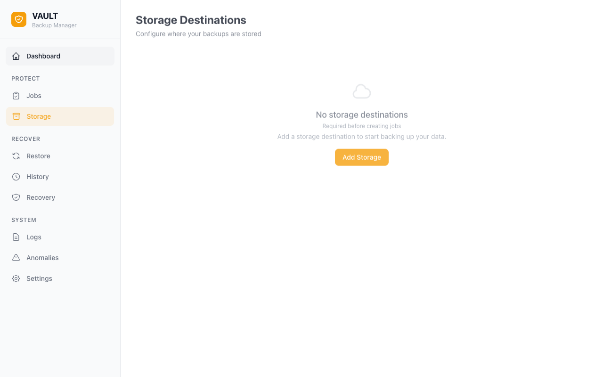
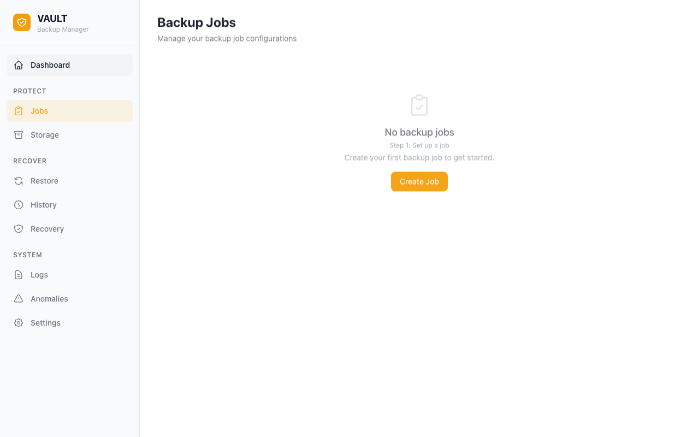
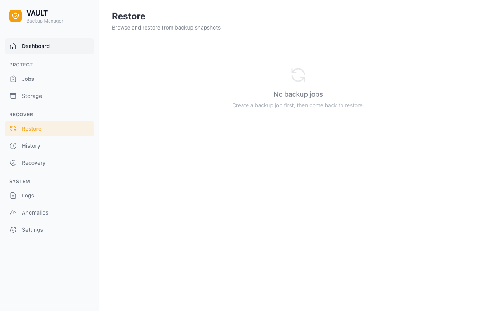

# Getting Started with Vault

Use this guide to install Vault and make your first backup.

## Prerequisites

- Unraid 7.0 or later.
- One storage destination. Vault supports local paths, SFTP, SMB, NFS, WebDAV, and S3-compatible object storage.

## 1. Install the Plugin

1. In the Unraid web UI, open **Plugins** → **Install Plugin**.
2. Paste this URL.

   ```text
   https://raw.githubusercontent.com/tinkerologie/vault/main/plugin/vault.plg
   ```

3. Click **Install**.

After installation, Unraid shows Vault under **Settings** → **Vault**.

## 2. Open the Vault UI

Click **Open Web UI** on the Vault settings page.

By default, Vault listens on `127.0.0.1`. The Unraid plugin proxy gives you access to the Vault UI on that address.

### Use port 24085 directly

1. In Unraid, open **Settings** → **Vault**.
2. Set **Bind Address** to the server's LAN IP address or `0.0.0.0`.
3. Click **Apply**.
4. Open `http://<your-unraid-ip>:24085`.

You can use the Unraid web UI without a Vault API key. If Home Assistant runs on another device, it cannot connect to the default loopback address. Use the LAN address and port `24085` in Home Assistant. Make an API key in Vault under **Settings** → **Security** → **API Access**. Enter the key when Home Assistant asks for it.

### Network discovery (mDNS)

When Vault listens on a non-loopback address, it publishes the `_vault._tcp` service over mDNS. Home Assistant uses this service to find Vault.

- Vault does not publish the loopback addresses `127.0.0.1` and `::1`.
- For a specific LAN IP address, Vault publishes that address only on its interface. A Docker or VM bridge on the same server can get that address if it queries Vault.
- For `0.0.0.0` or `::`, Vault publishes on all LAN interfaces. Each interface publishes only its own addresses.
- Vault publishes `vault-<hostname>.local`. If another device uses that name, Vault selects the next available name (for example, `vault-<hostname>-2.local`). The Unraid host name `<hostname>.local` stays the same.

To stop discovery, set **Network Discovery (mDNS)** to **No** under **Settings** → **Vault** in Unraid. You can also start the daemon with `--mdns=false`. The API stays available at the bind address.

The Dashboard shows the status of your backups. If a problem shows in the status banner, use the link to the applicable page.



## 3. Add a Storage Destination

Add a storage destination before you create a backup job.

1. Open **Storage** in the sidebar.
2. Click **Add Storage**.
3. Enter a name for the destination (for example, "NAS Backups").
4. Select a destination type.

   | Type       | Destination                                                                   |
   | ---------- | ----------------------------------------------------------------------------- |
   | **Local**  | A path on the Unraid array or an attached drive                               |
   | **SFTP**   | A server that supports SSH                                                    |
   | **SMB**    | A Windows share or a Samba server                                             |
   | **NFS**    | An NFS export                                                                 |
   | **WebDAV** | A WebDAV server such as Nextcloud, ownCloud, or Synology WebDAV               |
   | **S3**     | AWS S3 or compatible storage such as Backblaze B2, MinIO, R2, Wasabi, or MEGA |

5. Enter the connection settings. See [Storage Destinations](guides/storage-destinations.md) for the settings for each type.
6. Click **Test connection**.
7. If the test is successful, click **Save**.



## 4. Create a Backup Job

A backup job specifies the items, storage destination, schedule, and retention policy.

1. Open **Jobs** in the sidebar.
2. Click **Create Job**.
3. In **What**, select the items to back up. Vault shows Docker containers, VMs, ZFS datasets, folders, and plugins from your server. For containers, you can also specify subpaths to exclude.
4. In **Where & when**, select a storage destination. Set a schedule. For a manual job, leave the schedule empty.
5. In **How**, select **Full**, **Incremental**, or **Differential**. If necessary, change the compression and retention settings. You can keep a fixed number of restore points or use Long-Term Retention (LTR).
6. In **Name & review**, enter a name for the job.
7. Examine the summary.
8. Click **Create Job**.



## 5. Run Your First Backup

1. On **Jobs**, find the new job.
2. Click **Run Now** (the play icon).

Vault shows the progress while the backup runs. When the backup completes, the job card shows the last run time, duration, and size.

## 6. Verify and Restore

After a successful backup:

1. Open **Restore** in the sidebar.
2. Select your job.
3. Select a restore point.
4. Select the items to restore.
5. Confirm the restore.

For an incremental or differential restore point, Vault shows the full backup that starts its backup chain. Vault also shows the chain depth.



## What's Next

| Task                                               | Location                                                                                 |
| -------------------------------------------------- | ---------------------------------------------------------------------------------------- |
| Configure a storage destination                    | [Storage Destinations](guides/storage-destinations.md)                                   |
| Change retention, encryption, or deduplication     | [Backup Jobs](guides/backup-jobs.md)                                                     |
| Set a backup password                              | **Settings** → **Security** → **Encryption**                                             |
| Enable Discord notifications                       | **Settings** → **Notifications**                                                         |
| Replicate backups to a second Vault server         | **Replication**                                                                          |
| Verify a restore point                             | **Restore** → restore point → **Verify**                                                 |
| Repair deduplicated storage                        | `vault dedup repair --dest <id>`                                                         |
| Remove unreferenced data from deduplicated storage | `vault dedup gc --dest <id>`                                                             |
| Recover files without a Vault server               | [Disaster Recovery](guides/disaster-recovery.md#recovering-files-without-a-vault-server) |
| Download diagnostics                               | **Settings** → **Support** → **Download diagnostics bundle**                             |
| Use Home Assistant                                 | [ha-vault](https://github.com/tinkerologie/ha-vault)                                     |
| Use the REST API                                   | [API Reference](api.md)                                                                  |
| Use the MCP server                                 | [MCP](mcp.md)                                                                            |

### Prepare for recovery

1. Enable **Include in DB backup** on at least one storage destination.
2. Keep the backup password outside the server.
3. Keep a copy of the server key (`vault.key`) outside the server.

If you lose the server, follow the [Disaster Recovery guide](guides/disaster-recovery.md).

## Troubleshooting

### "Vault daemon not available" after saving a job

The daemon can restart before it responds to a save request.

1. Wait a few seconds.
2. Refresh the page.
3. Make sure that Vault shows the job.
4. If the error continues, open **Logs**.

### Configuration lost after reboot

Vault uses a working database in RAM. Vault saves copies to a cache pool and to the Unraid flash drive.

At startup, Vault selects the newest valid copy. It can use a cache snapshot, a rotated copy, a USB shadow, or the USB-direct database from a startup without a pool.

1. On the server, run `curl http://127.0.0.1:24085/api/v1/health`.
2. Read `startup.restoration` to find the source of the database.
3. If you set a custom snapshot path, make sure that the path is on persistent storage.
   Find the path under **Settings** → **General** → **Database Location**.

### What is `/mnt/user/.vault`?

Vault stores `vault.db` and its `rotated/` copies in `<pool>/.vault`. Unraid also shows top-level pool directories as user shares. Thus the same directory appears under `/mnt/user`.

Do not delete the directory while Vault runs. To move it, use **Settings** → **General** → **Database Location**. The adjacent `.vault-stage` directory holds temporary data.

### Fix Common Problems reports "Invalid folder vault-fuse contained within /mnt"

Older releases used `/mnt/vault-fuse` for FUSE backup mounts. Vault now uses `/mnt/addons/vault-fuse`. At startup, Vault removes the old directory if it is empty.

1. If the warning continues, make sure that no backup mount is active.
2. Restart Vault.

### Mirrored cache pool not detected

Vault scans `/mnt/` for pool mounts at startup. If Vault does not show the pool, make sure that Unraid mounts it before Vault starts. Set the snapshot path under **Settings** → **General** → **Database Location**.

### Diagnostics bundle for support

Open **Settings** → **Support** → **Download diagnostics bundle**. Vault puts system data, the database schema, recent runs, scheduler status, and the daemon log in a ZIP file. Vault removes credential values from the file.

Attach the ZIP file to the bug report.

## Optional: "Backups" link in the top navigation

The **Backups** entry opens Vault inside the Unraid web UI. The embedded view uses a row of links in place of Vault's header, sidebar, and bottom bar. It uses the Unraid theme until you select a theme in Vault.

The **Backups** entry is off by default. To enable it, open **Settings** → **Utilities** → **Vault** → **Quick Access** in Unraid. Vault uses the Unraid plugin menu to add this entry.
