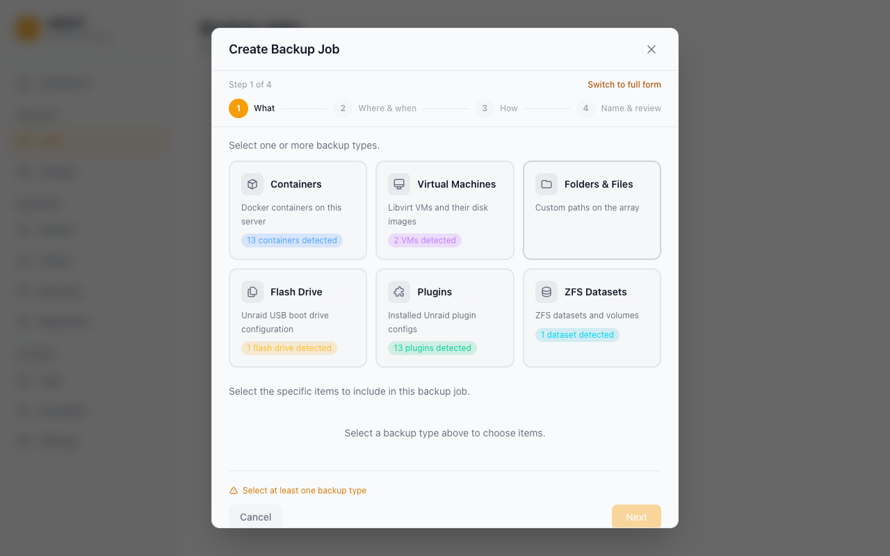

# Backup Jobs

A backup job defines _what_ to back up, _where_ to put it, _when_ to run, and how many copies to keep. This guide explains every option in the job wizard.

## Creating a Job

Go to **Jobs** → **Create Job**. The wizard has four steps.

---

### Step 1 — What

Select the items to include in this job. Vault lists items from your server.

| Category             | What's included                                                                                      |
| -------------------- | ---------------------------------------------------------------------------------------------------- |
| **Containers**       | Docker containers (image, XML template, and all mapped appdata volumes); per-container path excludes |
| **Virtual Machines** | libvirt VMs (live snapshot or cold backup depending on running state); NVRAM preserved               |
| **ZFS datasets**     | Native `zfs send`/`receive` with snapshot management                                                 |
| **Folders**          | Any arbitrary path on your server (e.g. `/mnt/user/appdata`, `/boot/config`)                         |
| **Plugins**          | Installed Unraid plugins                                                                             |

#### VM Restore Requests

A VM Restore Request shows the disks and NVRAM Vault will write and the domain definition Vault will create. The required chain starts at the VM's recorded full backup. Each required disk layer must be available before Vault stops or removes an existing domain. An alternate directory changes the disk and NVRAM paths for the same VM identity.

Vault checks the reviewed source and destination effects before execution. Libvirt actions and disk writes occur separately and can leave a partially restored VM if they fail or are interrupted. History shows whether Vault started the VM and which configured readiness checks ran. Application health stays unchecked.

#### Notes on containers

- Vault backs up the container image, its XML template, and the included host paths.
- Vault skips Unix sockets, device nodes, and named pipes. These files do not cause the backup to fail.
- Vault supports containers that use Tailscale.
- Vault skips bind mounts that point to the host root (for example, `/` → `/rootfs`). It does not scan the host filesystem for these mounts.

#### Mount point detection and auto-skip overrides

The job editor lists the bind mounts and named volumes for each container.

- **Appdata paths.** Vault includes paths such as `/mnt/cache/appdata/...` and `/mnt/user/appdata/...`. It also includes named volumes by default.
- **Shared data paths.** Vault excludes paths such as `/mnt/user/media`, `/mnt/user/downloads`, `/mnt/user/isos`, `/mnt/user/domains`, `/mnt/user/backups`, and `/mnt/remotes` by default. This prevents large backups of shared data.
- **Include a shared data path.** Select its mount in the job editor if the path contains application data (for example, an SQLite database). The mount shows `included (override)`.
- **System and hardware paths.** Vault always excludes `/dev`, `/proc`, `/sys`, `/run`, root `/mnt`, and direct `/mnt/diskN` paths. You cannot include these paths.
- **Databases.** For PostgreSQL, MySQL, or MariaDB, you can include a logical dump (`database.sql`). For a file-based database such as SQLite, include the directory mount.

#### Container database dumps

For containers that run PostgreSQL, MySQL, or MariaDB, Vault can make a logical SQL dump. Vault stores `database.sql` with the backup, outside the volume archive. If the job uses compression, the file has a `.gz` or `.zst` suffix.

Vault reloads the dump automatically if the backup identifies the dump as the authoritative copy. The dump is the consistent copy if Vault backed up the volumes while the database ran. Vault waits until the restored database is ready. Then it reloads the dump.

Vault keeps the dump as a separate file in these conditions:

- The volume has a newer, consistent copy because Vault stopped the database before it archived the volumes.
- The restored container did not run.
- The restored database did not become ready.

Vault moves the dump from temporary storage to a permanent location. The restore progress and logs show the path (`database dump saved to …`).

- With a custom destination, Vault uses `<destination>/<container>-database.sql` (with the compression suffix if applicable).
- Without a custom destination, Vault puts the file next to the first restored volume (for example, `/mnt/user/appdata/<container>-database.sql`).

Vault starts the file name with the container name to prevent conflicts in a shared directory. You can import the dump manually (for example, `mysql < database.sql` or `psql -f database.sql`). This procedure applies to classic and deduplicated backups.

#### Excluding container sub-paths

In the job wizard, you can list subpaths to exclude for each container. Examples include `/config/Library/Application Support/Plex Media Server/Cache` and `/config/Sonarr/MediaCover`.

The wizard uses `GET /api/v1/presets/exclusions` to show preset rules for applications such as Plex, Sonarr, and Radarr. It also shows `notes` and `warnings` from that response when available.

#### Container appdata path and volume exclusions

Vault includes application data by default and excludes most other bind mounts.

- **Appdata path.** Open **Settings** → **General** → **Docker Appdata Path**. Set **Appdata Directory**. The default is `/mnt/user/appdata`. Vault includes mounts under this path and `/mnt/cache/appdata`. It also includes Unraid configurations under `/boot`.
- **Other bind mounts.** Vault excludes paths such as `/mnt/user/media`, `/mnt/user/downloads`, and custom array paths by default. Vault includes Docker named volumes (for example, Compose volumes under `/var/lib/docker/volumes`).
- **Include a mount.** Open the container under **Container Mounts & Exclusions**. Select the shared data mount or other permitted mount.
- **System paths.** You cannot include device and virtual filesystem mounts (for example, `/dev`, `/proc`, `/sys`, `/mnt/disk*`, or root `/mnt`).

#### Auto-include new containers

You can enable **Auto-Include New Containers** for a container backup job.

- Vault adds new Docker containers to the job during scheduled or manual runs.
- For each new container, Vault includes appdata mounts and named volumes. It excludes bind mounts outside appdata by default.
- Vault does not add containers with the Docker label `vault.exclude`.
- Vault removes a container from the job after the container is absent for at least 24 hours. This prevents removal during short interruptions.

#### Backing up Immich

Immich detection works for both the official `ghcr.io/immich-app/immich-server` image (media root mounted at `/data`) and the imagegenius fork `ghcr.io/imagegenius/immich` (`/photos`). The recommended exclusions cover both layouts:

|                         | Always backed up (critical)               | Excluded (regeneratable)  |
| ----------------------- | ----------------------------------------- | ------------------------- |
| Official (`/data`)      | `upload`, `library`, `profile`, `backups` | `thumbs`, `encoded-video` |
| imagegenius (`/photos`) | `upload`, `library`, `profile`, `backups` | `thumbs`, `encoded-video` |

Thumbnails and re-encoded video are re-created by Immich on demand after a restore, so excluding them saves space without data loss. The `upload`/`library`/`profile` folders hold your original photos and videos and are never excluded.

Immich stores asset metadata in a PostgreSQL database in a separate container. A backup of the Immich container does not include this database. A file copy of a running database is not crash-consistent.

Use one of these methods:

1. **Use the Immich database backup.** Open **Administration** → **Settings** → **Backup Settings** in Immich. Enable the database dump. Immich writes `.sql.gz` files to `/data/backups` or `/photos/backups`. A Vault backup of the media root includes the photos and the dump.
2. **Use a separate Vault job.** Add the Immich PostgreSQL container to its own job. Vault stops the container before it archives the data directory.
3. **Use a pre-backup script.** Use `docker exec` to run `pg_dump` and write the dump to the media root. Vault runs the **Pre-backup script** before it stops containers. The script environment contains `VAULT_JOB_NAME`, `VAULT_STATUS`, `VAULT_JOB_ID`, and `VAULT_RUN_ID`.

#### Notes on ZFS datasets

Vault uses `zfs send` for full backups and `zfs send -i` for incremental backups. Vault also manages the snapshots.

Vault restores with `zfs receive -F`. This command keeps properties and child datasets. It overwrites the dataset in the job item. For a local job without a configured dataset, Vault uses the dataset name of the item.

For an imported or replicated job, set a dataset on the item or select a dataset as the restore destination. Vault refuses the restore without an explicit target for these jobs. Vault does not select a pool root as the restore destination automatically.

After an upgrade, examine the target of jobs that an older version imported. The target can be a dataset name from the backup. Vault marks older imported items during upgrade if it can find their run history. If you purged that history, Vault treats the job as local.

The restore uses the local values for `mountpoint`, `canmount`, and `overlay`, or inherits them. Vault mounts the dataset after the receive. The host must have the `zfs` binary on `PATH`.

#### Notes on folders

- You can back up `/mnt/user/appdata` to get all container appdata in one shot without selecting individual containers.
- Folder backups only wake the destination disk when writing — the source array is read sequentially.

---

### Step 2 — Where & when

Select which storage destination this job will write to. If you have not added one yet, save the wizard and go to **Storage** first — see [Storage Destinations](storage-destinations.md). This step also sets the schedule.

#### Schedule

| Option            | Description                                                                |
| ----------------- | -------------------------------------------------------------------------- |
| **Hourly**        | Runs at a fixed minute past every hour                                     |
| **Daily**         | Runs at a specific time each day                                           |
| **Weekly**        | Runs on selected days of the week at a specific time                       |
| **Monthly**       | Runs on a specific day of the month (or First/Last day) at a specific time |
| **Yearly**        | Runs on a specific month and day at a specific time                        |
| **Custom (cron)** | Any valid cron expression for advanced schedules                           |

**"First day" and "Last day" of month:**
You can select _First day of month_ or _Last day of month_ in place of a day number. Vault uses the last day for the specified month (28, 29, 30, or 31).

**Custom (cron):**
Select **Custom** to enter a cron expression. For example, `0 */3 */2 * *` runs every three hours on every second day. The five fields are `minute hour day-of-month month day-of-week`. Vault accepts `*`, `*/step`, `from-to`, and `a,b,c`. Use `L` for the last day of the month. Vault also accepts descriptors such as `@daily` and `@hourly`.

The form validates the expression as you type. The server validates it again when you save. The server rejects expressions it cannot schedule. You can use a custom expression for backups, verification, or replication sync.

**Time format:**
The schedule UI uses your Unraid time format setting (12-hour or 24-hour) automatically.

To create a manual job, leave the schedule empty. To start the job, click **Run Now**.

---

### Step 3 — How

Select the backup type. Use _Advanced options_ to change compression, retention, verification, or scripts.

#### Backup Types

| Type             | What it backs up                          | Restore speed                                               | Storage use                   |
| ---------------- | ----------------------------------------- | ----------------------------------------------------------- | ----------------------------- |
| **Full**         | Everything, every run                     | Fastest — single archive                                    | Highest — full copy each time |
| **Incremental**  | Changes since the last backup of any type | Uses the full backup and the applicable incremental backups | Lowest                        |
| **Differential** | Changes since the last _full_ backup      | Uses the full backup and one differential backup            | Medium                        |

#### Scheduled full backups

An incremental or differential job can run its own periodic **full** backup, under _Advanced options → Scheduled full backup_. It takes a second schedule, independent of the job's: hourly incrementals with a full every Sunday at 04:00, for example.

An incremental or differential restore uses the applicable backup chain from the last full backup. A periodic full restarts the chain, which keeps restores fast and bounds how much a single damaged archive can cost you. Before this option the only way to get one was a duplicate job that differed solely in backup type.

The option is hidden for **Full** jobs — every run is already a full — and clearing it turns the extra cadence off.

!!! note "First run of an Incremental or Differential job"

    On the very first run there is no parent backup to attach to, so an **Incremental** or **Differential** job automatically performs a **Full** backup and only later runs capture changes. Choosing Incremental or Differential from the start is the correct workflow — there is no need to run a manual Full first.

For most home server use cases, a weekly **Full** backup with daily **Incremental** runs gives a good balance between storage cost and restore speed.

#### Retention

Retention controls how many restore points are kept before the oldest is deleted. (A _restore point_ is one completed backup you can restore from.) Vault supports two modes. If any Long-Term Retention value is set, LTR is used and the simple settings are ignored.

**Mode 1 — Simple count**

| Field                          | Description                                                                                                                                                                |
| ------------------------------ | -------------------------------------------------------------------------------------------------------------------------------------------------------------------------- |
| **Keep last N restore points** | Vault keeps this many restore points per job. When a new backup completes and the count exceeds the limit, the oldest is pruned — including its backup files from storage. |

Good for "always keep my last 7 backups" type policies.

**Mode 2 — Long-Term Retention (LTR)**

| Field            | Description                                                                          |
| ---------------- | ------------------------------------------------------------------------------------ |
| **Keep latest**  | Number of _most-recent_ restore points kept unconditionally (independent of cadence) |
| **Keep daily**   | Number of distinct _days_ to retain (one restore point per day)                      |
| **Keep weekly**  | Number of distinct _weeks_ (one restore point per week)                              |
| **Keep monthly** | Number of distinct _months_ (one restore point per month)                            |
| **Keep yearly**  | Number of distinct _years_ (one restore point per year)                              |

Long-Term Retention (LTR) can keep restore points for different time intervals. For example, keep points for 7 days, 4 weeks, 6 months, and 3 years. Before you save, the retention preview shows which restore points Vault will remove on the next run.

If you leave all LTR counters at 0, classic simple retention applies. If any LTR counter is greater than 0, Vault uses LTR for that job and ignores the simple settings (_Keep last N_ and _keep-for-N-days_).

Set retention based on storage budget and how far back you want to be able to restore:

- 7 daily backups → simple count = 7
- A weekly full + 6 daily incrementals → simple count = 7, two jobs (one weekly full, one daily incremental)
- Year of history without storage bloat → LTR with `keep_daily=7`, `keep_weekly=4`, `keep_monthly=12`, `keep_yearly=3`

---

### Step 4 — Name & review

| Field    | Description                                                                     |
| -------- | ------------------------------------------------------------------------------- |
| **Name** | A unique name for this job. Shown on the Dashboard, History, and Restore pages. |

Examine the job summary. Click **Create Job**.

---

## Running a Job Manually

To start a backup immediately:

1. Go to **Jobs**
2. Click the **Run Now** button on the job card (play icon)

Vault sends progress updates through WebSocket. The run appears in **History** when complete.

---

## Monitoring Progress

While a job is running:

- The Dashboard shows a live progress indicator
- The **History** page lists the run with status "Running"
- The **Logs** page shows per-item progress entries including container name, backup type, storage destination, and elapsed time

---

## Cancelling a Running Job

To stop an in-progress backup:

1. Go to **Jobs** (or the Dashboard's **Backup in progress** tile)
2. Click the **Cancel** button on the running job

Vault signals cancellation through the entire pipeline — file I/O, directory traversal, and engine handlers all check for cancellation and stop gracefully. The job is marked as "cancelled" in History.

Cancel also works on a job that is **queued** behind another run (for example after clicking Run Now while a scheduled backup is active) — the queued run is removed before it starts. Deleting a job that is currently running cancels the run first.

Jobs also have an automatic safeguard:

- **2-hour stall detection** — a job with no progress for 2 hours is cancelled (with a warning at 30 minutes). There is no overall time limit: a backup that is still transferring data has no total time limit.

---

## Acknowledging Reviewed Runs

1. On the Dashboard, click the **Review** link for the warning to open filtered History.
2. Review the original run outcome and details.
3. If necessary, enter a reason.
4. For one run, click **Acknowledge**. For multiple runs, select the runs. Then click **Acknowledge selected**.

**Select all needing review** includes all matching runs in the loaded history, including runs on later pages.

History keeps the original result, logs, and acknowledgement details. Clear **Needs review** to see runs you already acknowledged. Acknowledged runs stop contributing to outstanding Dashboard warnings. Historical success rates still include their original outcomes. Acknowledgement is available on the primary Vault instance.

---

## Deleting a Job

To delete a job:

1. Go to **Jobs**
2. Click the **...** menu → **Delete**
3. Select **Keep backup files** or **Delete backup files**.

Deleting backup files removes the archives from the storage destination. Keeping them leaves the files in place — useful if you plan to import them into a new job later.

---

## Deleting Individual Restore Points

To delete a specific backup without touching the job or other restore points:

1. Go to **Restore** in the left sidebar
2. Select the job
3. Find the restore point and click the **trash icon**
4. Confirm the deletion

This removes both the backup files from storage and the restore point record from the database.

---

## Stop an approved Restore Run

Open the Restore Request on the signed-in Unraid Vault page. While the run is active, select **Stop Restore Run** and confirm the run ID and restore location. Stopping can leave the restore location partly restored. Check the recorded outcome in the request. If the restore finishes before it can stop, Vault shows the outcome of that restore.

## Restoring Across Backup Jobs

The Restore wizard supports selecting items that belong to different backup jobs (for example, restoring containers from an appdata job together with a VM from a virtualisation job):

1. **Step 1 (Select Items):** Select any combination of backed-up items across different jobs.
2. **Step 2 (Choose Versions):** The timeline aggregates restore points from each backup job covering your selected items:
   - Each restore point indicates its source job name and a coverage label (such as _"Contains 2 of 3 selected items"_ or _"Contains all 3 selected items"_).
   - If an item is missing, Vault shows the reason. The item can be absent from the job or from that backup.
   - Some older restore points have no item manifest. Vault shows _"Item list not recorded for this backup"_ and lets you select items from that job.
   - Select one restore point for each source job. The summary shows the version of each selected item and identifies items without a restore point.
   - If an item has no restore point, remove it from the selection or return to the item selector.
3. **Step 3 (Restore Options & Pre-Flight):**
   - Examine each source job separately. Each job has its own destination overrides, passphrase, clean destination option, and file selection.
   - Vault does pre-flight checks for each job before the restore starts.
   - Vault restores the jobs in sequence. Vault shows progress and logs for each job.
   - Two container approvals are off by default. Vault stops and lists the requested host permissions if an imported or replicated backup requests privileged mode, host networking, devices, or host paths. Select _Allow host-level access_ to give those permissions.
   - If Vault cannot get the image by digest for a deduplicated backup, you can select _Use the image's current tag_. Otherwise Vault uses the image from the backup. If Vault changes the tag and the restore fails, it puts the previous image tag back. After a restore, Unraid reports updates for the image in the restored container.

<!-- prettier-ignore -->
!!! note
    This wizard flow restores regular backup items. To recover the Vault configuration, database, or plugin state after a system failure, see [Disaster Recovery](disaster-recovery.md#recovering-with-the-wizard).

---

## Managing Stale Items

Vault shows **"Not found"** in the job if it cannot find a container, VM, ZFS dataset, or folder. To remove the item from the job, click **remove** next to it. The folder picker checks each custom path with `GET /api/v1/path-exists`.

---

## Verification

Vault calculates a SHA-256 digest for each item during upload. Vault stores the digest with the restore point.

- **Per-run verification.** If **Verify backups after writing** is on (the default), Vault reads each item from storage after the backup. It calculates the digest again. A mismatch causes the run to fail.
- **On-demand verification.** To verify a restore point, click _Verify_ on the Restore page. Vault records the result in `verify_runs` and in the restore point's verification history. The result includes byte counts and errors for each item.

The two procedures use the same code.

### Scheduled verification and backup contention

Use _Verify schedule_ to set a cron schedule for verification. **Quick** verification checks that each item exists and has the correct size. **Deep** verification reads each item and calculates its digest again.

Vault postpones scheduled deep verification if a backup runs on the same storage destination. The activity log records this decision (`Deep verify for "<job>" deferred: a backup is running on the same storage destination`). Vault tries again at the next scheduled time. Quick verification can run during a backup. Vault does not postpone on-demand verification.

---

## Encryption

Set a backup password under **Settings** → **Security** → **Encryption**. In the job, select **Age Encryption** in **Encryption**. For a classic backup, Vault encrypts the archives before it uploads them. Use the backup password to restore a classic backup with age encryption. This procedure applies to all storage types.

The encryption status is shown on the Dashboard's 3-2-1 compliance widget, and on each restore point's chain-health badge (along with details on the referenced full backup for chained restores).

---

## Deduplication

Deduplication keeps one copy of each unique chunk. See [How Backup Works](../how-backup-works.md#deduplication).

If _Dedup_ is on for a destination, Vault uses Keyed-FastCDC to divide backups into chunks. The minimum, average, and maximum sizes are 256 KiB, 1 MiB, and 4 MiB. Vault stores the repository in `<dest>/_vault/packs/` and `<dest>/_vault/index/`.

Each destination uses a 32-byte secret to set the chunk boundaries. This prevents the fingerprinting attack in Truong et al. 2025. An observer without the secret cannot calculate the boundaries from public data.

Operational notes:

- Each backup writes a per-item manifest into the dedup repo. The `manifest_id` (or `item_manifests` map for multi-item jobs) is stored on the restore point so restores can resolve chunks.
- The Storage card shows live dedup stats (chunks, packs, logical/physical bytes, dedup ratio).
- `vault dedup gc --dest <id>` and `POST /api/v1/storage/{id}/gc` start garbage collection. Vault reads the manifest of each live restore point and marks its chunks. Vault deletes packs with no marked chunks. If compaction is on, Vault can move the marked chunks to new packs. It deletes the old pack only after it moves all marked chunks. If Vault cannot read a manifest or its metadata, it stops before it deletes data. Repair or delete the affected restore point before you retry. If the Vault service runs, use the API or the Storage page.
- `vault dedup repair --dest <id>` rebuilds the SQLite index for chunks and packs from the `*.idx` files on storage. Use this command if the local database is lost or damaged and the destination is available. Stop Vault before you run the command.
- Vault can use destinations with and without deduplication. Set the option when you add a destination. You cannot change the option later.

On **Storage**, click **Import** on the destination. Click **Scan** in **Import Backups**. The `manifest.json` files contain deduplication manifest IDs for each item. Vault uses AES-256-GCM for manifests on deduplicated destinations. Vault uses age for manifests from jobs with age encryption. If Vault finds an age-encrypted manifest, enter the backup password to import the metadata.

---

## Job Queue & Queue Management

The runner uses a mutex to do one backup or restore at a time. If Vault receives another backup or restore request during an active operation, it puts the request in the queue in memory.

- **History** shows the **Active & Queued Operations** card. It lists the job name, the queue time, and the status (`Queued` or `Running`). It also lists the operation type (`Backup`, `Restore`, or `Cleanup`). Vault sends updates over WebSocket.
- To cancel a backup or restore before it starts, click **Cancel** on **History**. Confirm the cancellation.
- You cannot cancel background storage deletion or remote orphan cleanup from the queue. These operations continue until they finish.

---

## Next steps

- Point your job at the right target: [Storage Destinations](storage-destinations.md)
- Let Vault warn you when backups drift from normal: [Anomaly Detection](anomaly-detection.md)
- Make sure you can recover if the server dies: [Disaster Recovery](disaster-recovery.md)

## Restore locations

Vault runs as root and treats paths read from a backup as untrusted, so restores
only write to these locations:

| Restore                   | Allowed locations                                                                                                                                |
| ------------------------- | ------------------------------------------------------------------------------------------------------------------------------------------------ |
| Custom destination        | Under `/mnt`, a temp directory, or `/boot/config/plugins/<name>`                                                                                 |
| Container volume in place | Under `/mnt`, `/var/lib/docker/volumes/<name>/_data`, `/boot/config/plugins/<name>`, or a bind the same-named container on this host already has |
| VM disk in place          | Under `/mnt` or `/var/lib/libvirt/images`                                                                                                        |
| VM NVRAM in place         | `/etc/libvirt/qemu/nvram`, `/var/lib/libvirt/qemu/nvram`, or under `/mnt`                                                                        |
| Folder in place           | The job's own path, which can be anywhere except protected system trees such as `/etc`, `/usr` and `/var/lib`                                    |

If a restore is refused, pick a custom destination under `/mnt` and move the data
afterwards. A custom destination for a VM must be under `/mnt` or a temp directory. A
symlink that leads outside these locations is refused too.
