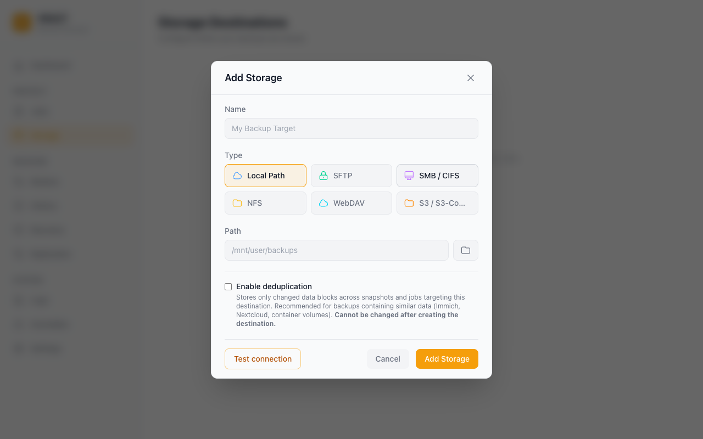

# Storage Destinations

Click **Browse** on a storage destination to see its files. The browser is read-only. You can also use it in replica mode.

Vault writes compressed (and optionally encrypted) backup archives to a storage destination. This page explains how to configure each supported type.

## Overview



| Type       | When to use                                                                                 |
| ---------- | ------------------------------------------------------------------------------------------- |
| **Local**  | Unraid array share, directly attached USB/SSD, or any locally mounted path                  |
| **SFTP**   | Any Linux/BSD server reachable by SSH — another NAS, a VPS, a cloud VM                      |
| **SMB**    | Windows shares and Samba servers, including Synology and TrueNAS SCALE                      |
| **NFS**    | NFS exports from Linux/BSD servers and most NAS devices                                     |
| **WebDAV** | Stateless HTTP backup target — Nextcloud, ownCloud, Synology WebDAV, generic WebDAV servers |
| **S3**     | AWS S3 and S3-compatible object storage — Backblaze B2, MinIO, Cloudflare R2, Wasabi        |

---

## Local

| Field                             | Description                                                                                                                                                                                                 |
| --------------------------------- | ----------------------------------------------------------------------------------------------------------------------------------------------------------------------------------------------------------- |
| **Path**                          | Absolute path to a dedicated folder for Vault's backups (e.g. `/mnt/user/backups/vault`). The directory must exist and be writable by the `vault` process. See [Allowed local paths](#allowed-local-paths). |
| **Stage beside this destination** | Stage temporary backup archives in a `.vault-stage` directory on this destination's disk rather than in cache pools or system temp.                                                                         |

**Notes:**

- Local destinations are the fastest option — no network overhead.
- Avoid putting backups on the same array as the source data if you want protection against disk failure.
- Vault wakes the destination disk when it writes data. Vault does not keep disks active between runs.
- **Use a dedicated folder.** Vault keeps its backups in `<job name>/<run>/` folders, plus `_vault/` for deduplicated data and database backups. Other files in the folder are never deleted, but a dedicated folder keeps backups easy to find and manage.
- **Staging beside the destination.** If you enable this option, Vault puts temporary archives in the hidden `.vault-stage` directory on the destination disk. This reduces the space that large archives use on cache drives. Vault excludes `.vault-stage` if the destination is inside the backup source.

### Allowed local paths

Vault runs as root, so it refuses local destinations that could expose system files to its cleanup (issue #514). The rules apply when you save or test a destination, and again every time Vault uses one. A saved destination that breaks them stops working until you edit its path. You can still delete it with **Keep backup files**.

| Rejected path                                                                                                                                                | Why                                                                |
| ------------------------------------------------------------------------------------------------------------------------------------------------------------ | ------------------------------------------------------------------ |
| An empty or relative path                                                                                                                                    | It would resolve against the daemon's working directory.           |
| `/`, `/usr` (including `/usr/local/emhttp`), `/etc`, `/boot`, `/root`, `/bin`, `/sbin`, `/lib*`, `/proc`, `/sys`, `/dev`, `/run`, and system parts of `/var` | System and Unraid WebGUI files, and anything below them.           |
| Any folder that contains one of those, such as `/var`                                                                                                        | It contains protected system files.                                |
| `/mnt`, `/mnt/user`, `/mnt/user0`, `/mnt/disks`, `/mnt/remotes`, `/mnt/addons`, `/tmp`, `/home`, `/opt`, `/srv`, `/media` themselves                         | Shared parents. Use a subfolder such as `/mnt/user/backups/vault`. |

Vault checks the path as typed and again after following symlinks, so a link that points at a protected location is rejected too. A pool or disk root such as `/mnt/backup_pool` is allowed. The directory picker cannot select its root listing or a rejected folder.

### Deleting a destination and its files

**Delete Storage & Files** removes only data that Vault can prove it owns:

- Restore points that Vault recorded for jobs on the destination
- Run directories that contain a Vault `manifest.json`
- The deduplication repository in `_vault/`

Vault's database backups in `_vault/` are kept, and so is everything else in the folder. If some files could not be removed, the destination is still deleted and the page shows a warning. If Vault cannot open or list the destination, nothing is deleted, the destination is kept, and you can select **Keep backup files**. Deleting a job or a restore point, and retention cleanup, follow the same rules.

---

## SFTP

| Field                    | Description                                                                                                                                                           |
| ------------------------ | --------------------------------------------------------------------------------------------------------------------------------------------------------------------- |
| **Host**                 | Hostname or IP of the SSH server                                                                                                                                      |
| **Port**                 | SSH port (default: `22`)                                                                                                                                              |
| **Username**             | SSH user with write access to the remote path                                                                                                                         |
| **Password**             | Password for the SSH user (not required if using a key)                                                                                                               |
| **Remote Path**          | Absolute path **on the SSH server** where Vault will store backups (e.g. `/volume1/vault-backups`). The directory must exist and the user must have write permission. |
| **Host Key Fingerprint** | Optional. The server's SHA-256 host key fingerprint, from `ssh-keygen -lf /etc/ssh/ssh_host_ed25519_key.pub` on the server.                                           |

**Host key verification.** Vault uses the configured `known_hosts_file` or **Host Key Fingerprint** if present. If neither is present, Vault records the first key it receives in **Logs**. On later connections, Vault refuses a different key from that address.

If the network is untrusted, compare the fingerprint in **Logs** with the server's fingerprint. If you replace the server, Vault shows both fingerprints when the connection fails. Confirm the new fingerprint. Then enter it in **Host Key Fingerprint**. An unreadable `known_hosts_file` or an incorrectly formatted fingerprint causes an error.

**Tips:**

- Prefer key-based authentication for unattended backups. Add the Unraid server's public key (`~/.ssh/id_rsa.pub`) to the remote user's `~/.ssh/authorized_keys`.
- Test the connection before saving — Vault will attempt to list the remote directory and report any permission or connectivity errors.
- SFTP is the most broadly supported remote protocol and works with virtually any server running OpenSSH.
- Each upload pipelines up to 64 requests using compatible 32 KiB packets, including compressed or encrypted streams whose size is unknown. This avoids waiting for a network round trip per packet. **Parallel uploads** controls how many files Vault uploads at the same time. Vault uses pipelining for each file.

---

## SMB / CIFS

| Field        | Description                                                                                                                           |
| ------------ | ------------------------------------------------------------------------------------------------------------------------------------- |
| **Host**     | Hostname or IP of the SMB server                                                                                                      |
| **Share**    | The top-level SMB share name as configured on the server (e.g. `Backups`). This is the share name only — not a path.                  |
| **Path**     | Optional sub-folder **within the share** where Vault will write its data (e.g. `vault/my-server`). Leave blank to use the share root. |
| **Username** | SMB user with write access                                                                                                            |
| **Password** | SMB password                                                                                                                          |
| **Domain**   | Windows domain (leave blank for workgroup/Samba)                                                                                      |

**Understanding Share vs Path:**

```
SMB server: \\nas\Backups\vault\my-server
             └── host   └── share
                              └── path (sub-folder within share)
```

The **Share** field maps to the first component after the hostname. The **Path** field is everything after that.

**Tips:**

- SMB is the best choice for Synology NAS, Windows Server, and TrueNAS SCALE.
- Vault enforces a 30-second dial timeout so a misconfigured SMB destination will fail fast rather than hanging.

---

## NFS

| Field           | Description                                                                                                                                                          |
| --------------- | -------------------------------------------------------------------------------------------------------------------------------------------------------------------- |
| **Host**        | Hostname or IP of the NFS server                                                                                                                                     |
| **Export Path** | The path the NFS server exports — matches the entry in `/etc/exports` on the server (e.g. `/mnt/user/backups`). This is what gets mounted, not a sub-path within it. |
| **Base Path**   | Optional sub-directory **within the mounted export** where Vault will write its data. Leave blank to use the export root directly.                                   |

**Understanding Export Path vs Base Path:**

```
NFS server exports: /mnt/user/backups
                     └── export path (what gets mounted)

Vault writes to:    /mnt/user/backups/vault/my-server
                                      └── base path (sub-folder within mount)
```

**Tips:**

- The export path must be listed in `/etc/exports` on the NFS server and the Unraid server's IP must be allowed.
- Vault uses NFS version 4 by default. Make sure that the server has `nfs-utils` or an equivalent package.
- NFS offers the lowest overhead for LAN backups to a Linux-based NAS.

---

## WebDAV

| Field                                  | Description                                                                                                                                                                                                        |
| -------------------------------------- | ------------------------------------------------------------------------------------------------------------------------------------------------------------------------------------------------------------------ |
| **Server URL**                         | Full URL to the WebDAV endpoint, e.g. `https://nextcloud.example.com/remote.php/dav/files/username/` for Nextcloud or `https://webdav.example.com/` for a generic server. Must start with `http://` or `https://`. |
| **Username**                           | WebDAV username (leave blank for anonymous access — not recommended for production).                                                                                                                               |
| **Password / App Token**               | Password or app-specific token. For Nextcloud, generate an [app password](https://docs.nextcloud.com/server/latest/user_manual/en/session_management.html) under Settings → Security.                              |
| **Base Path**                          | Optional sub-folder under the server URL where Vault will write its data.                                                                                                                                          |
| **Allow self-signed TLS certificates** | Skip TLS validation. Only enable for trusted private servers.                                                                                                                                                      |
| **Chunk size (MiB)**                   | Optional. Files larger than this are split into independent WebDAV PUT requests with a manifest sidecar. Default `0` = 50 MiB. Set `-1` to disable chunking.                                                       |
| **Stall timeout (seconds)**            | Optional. Abort an upload if no bytes flow for this many seconds. Default `300`. Set `-1` to disable the stall watchdog.                                                                                           |
| **Overall request timeout (seconds)**  | Optional time limit for each WebDAV request. The default of `0` gives no time limit. Use this value for large backups on slow connections.                                                                         |

**Security Best Practices:**

- **Use a dedicated, least-privileged service account** scoped only to the backup directory — do not reuse a personal or admin account.
- **Avoid anonymous access for production backups.** Anonymous writes leave the destination open to unauthenticated tampering and prevent per-account auditing.
- **Always use TLS (`https://`).** WebDAV uses HTTP Basic or Digest authentication. Without TLS, Basic sends credentials in cleartext. Digest authentication also exposes credentials to attacks without TLS.
- **Restrict server-side write permissions to the backup path.** Configure the WebDAV server so the service account cannot read or modify other users' data.

**Notes:**

- WebDAV is **stateless HTTP**: each operation opens its own connection and closes it. This avoids the per-user concurrent-connection caps that affect SFTP/SMB on managed providers like Synology and TrueNAS.
- Vault uploads large WebDAV files in chunks and writes a small JSON manifest. If the network fails during an upload, Vault retries the current chunk.
- Existing non-chunked WebDAV backups remain readable. Vault detects a chunk manifest when present and falls back to the original single-file read path otherwise.
- Vault uses `gowebdav`'s auto-auth, so Basic and Digest authentication are negotiated automatically.
- For Nextcloud, the server URL **must** include `/remote.php/dav/files/<username>/` — the share-root WebDAV endpoint is not the file-storage endpoint.
- For ownCloud, use `/remote.php/webdav/`.

---

## S3 / S3-Compatible

| Field                           | Description                                                                                                                                                                                                            |
| ------------------------------- | ---------------------------------------------------------------------------------------------------------------------------------------------------------------------------------------------------------------------- |
| **Bucket**                      | Existing S3 bucket name. Vault will not create the bucket for you.                                                                                                                                                     |
| **Region**                      | AWS region code (e.g. `us-east-1`). For S3-compatible providers, use the region required by the provider (e.g. `us-west-002` for Backblaze B2).                                                                        |
| **Access Key ID**               | IAM user access key with `s3:GetObject`, `s3:PutObject`, `s3:DeleteObject`, `s3:ListBucket` on the bucket.                                                                                                             |
| **Secret Access Key**           | Matching secret key.                                                                                                                                                                                                   |
| **Endpoint**                    | Optional. Required for S3-compatible providers. Examples: `https://s3.us-west-002.backblazeb2.com` (B2), `https://<account>.r2.cloudflarestorage.com` (R2), `http://minio.local:9000` (MinIO). Leave blank for AWS S3. |
| **Base Path**                   | Optional key prefix prepended to every object Vault writes.                                                                                                                                                            |
| **Force path-style addressing** | Enable for older S3-compatible servers (e.g. older MinIO) that do not support virtual-hosted-style buckets. For AWS S3, leave this setting off.                                                                        |
| **Upload timeout (minutes)**    | Optional. Hard ceiling on a single object upload (including multipart transfers). Default `0` = 240 (4 hours). Raise for very large files over slow links.                                                             |
| **Part size (MiB)**             | Part size for multipart uploads. A value of `0` uses 64 MiB. S3 permits a maximum of 10,000 parts. With the default part size, this gives a maximum of 625 GiB. The permitted part size is 5 to 5120 MiB.              |

**Provider notes:**

- **AWS S3** — Leave Endpoint blank. Region must match the bucket's region.
- **Backblaze B2** — Use the S3-compatible endpoint shown in your bucket's settings (e.g. `https://s3.us-west-002.backblazeb2.com`) and the matching region (`us-west-002`).
- **MinIO** — Set Endpoint to your MinIO base URL (`http://minio.local:9000`). Enable **Force path-style** for older releases.
- **Cloudflare R2** — Use endpoint `https://<account-id>.r2.cloudflarestorage.com` and region `auto`.
- **Wasabi** — Use endpoint `https://s3.<region>.wasabisys.com`.
- **MEGA S3** — Use the S3 endpoint from your MEGA storage settings. The `SignatureDoesNotMatch` error MEGA used to return on every PutObject is now handled automatically (see Tips).
- **IDrive E2 / iDrive360** — Use the regional endpoint shown in the IDrive panel. Same checksum-trailer handling as MEGA / B2.

**Tips:**

- Vault uses the AWS SDK v2's reusable client, which pools HTTP connections internally — a single S3 destination can sustain many concurrent uploads.
- Server-side encryption is your provider's responsibility. Vault's own encryption (Settings → Security) layers on top and protects backups even from the storage operator.
- **`SignatureDoesNotMatch` during upload.** Some S3-compatible providers reject the checksum trailer that the AWS SDK sends. The connection test can pass because it sends no file data. Vault omits the trailer when you set a custom **Endpoint**. Vault still uses its own SHA-256 verification. If the error continues, examine the endpoint URL and region.
- **Part size.** S3 permits a maximum of 10,000 parts for each upload. The maximum object size is `part_size × 10,000`. The 64 MiB default permits an object of approximately 625 GiB. Part sizes of 256 MiB, 512 MiB, and 1 GiB permit approximately 2.44 TiB, 4.88 TiB, and 9.77 TiB.

  Estimate peak upload memory as `part_size × 5 × parallel_uploads`. The default of three parallel uploads uses approximately 960 MiB with 64 MiB parts. With 1 GiB parts, it uses approximately 15 GiB. Set **Memory limit** under **Settings** → **General** → **Memory** to a value more than this estimate. Above this soft limit, the garbage collector runs more often. The Memory card identifies jobs that can exceed the limit. The run log shows a warning when an affected upload starts. AWS S3, Backblaze B2, MinIO, Cloudflare R2, and Wasabi accept parts from 5 MiB to 5 GiB.

---

## Testing a Connection

After filling in the fields, always click **Test connection** before saving. What the test checks depends on the destination type:

- **All types** — the destination is reachable and the credentials work.
- **Local, SFTP, NFS, WebDAV** — Vault also writes and deletes a small test file, so write access is confirmed. On local destinations the test file has a unique name, so an existing file is never overwritten.
- **S3** — Vault only checks that the bucket exists and is accessible (no data is written).
- **SMB** — Vault only lists the configured directory (no data is written).

If the test fails, correct the problem before you save. An S3 or SMB test can pass on a read-only bucket or share because the test does not write data.

---

## Importing Existing Backups

If you have existing Vault backups (or AppData Backup archives) on a storage destination, you can import them:

1. Go to **Storage** and find the destination
2. Click the **...** menu → **Import Backups**
3. If your backups are in a sub-folder, enter the sub-folder path in the **Subfolder** field (e.g. `appdata-backups/`)
4. Click **Scan** — Vault will list all importable archives it finds
5. Select the archives to import and click **Import**

Vault shows imported backups as restore points on their jobs. Vault imports a Vault backup directory with a Vault `manifest.json` or an AppData Backup archive in an `ab_*` directory.

---

## Encryption

If you enable age encryption for a classic backup job, Vault encrypts its archives before upload. Keep the backup password in a safe place. Use the password to restore the encrypted backup.

Vault applies age encryption the same way for all storage types.

---

## Next steps

- Create a job that writes to your new destination: [Backup Jobs](backup-jobs.md)
- Keep a copy of your settings with your data for recovery: [Disaster Recovery](disaster-recovery.md)
