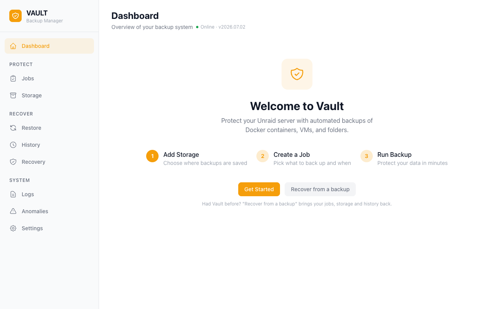
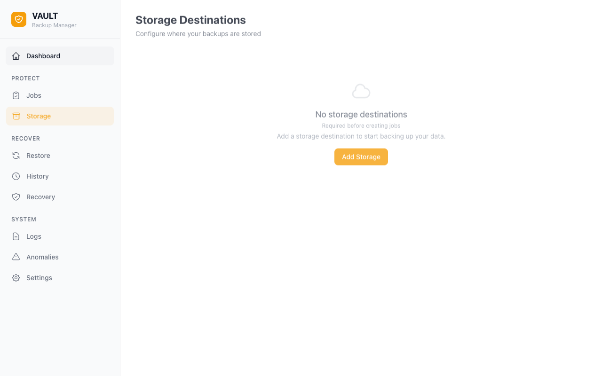
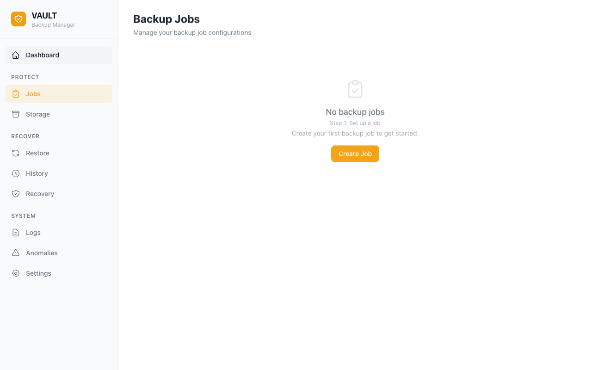
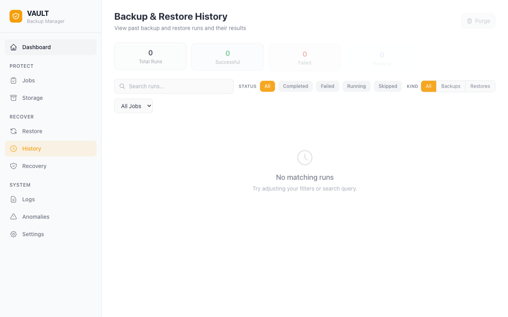
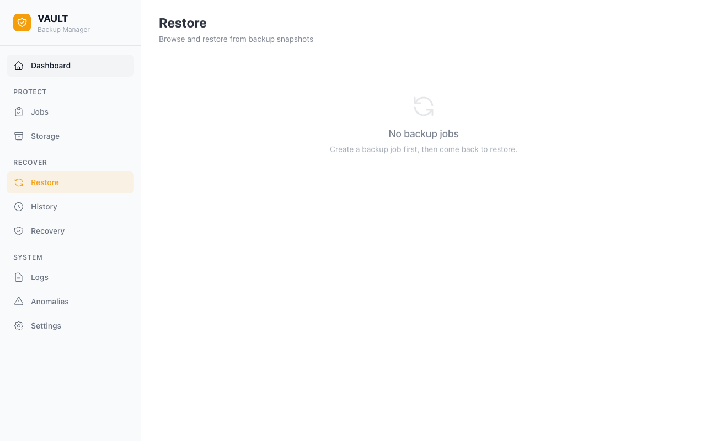

# Vault

Vault is a backup and restore daemon for [Unraid](https://unraid.net/) servers.
It can back up Docker containers, libvirt virtual machines (VMs), ZFS datasets, folders, and Unraid plugins.
Vault supports local disk, SFTP, SMB, NFS, WebDAV, and S3-compatible storage.

**[Get started](getting-started.md)**

## What you can do

- Set a bandwidth limit for each storage destination.
- Use full, incremental, or differential backups.
- Keep a fixed number of restore points or use Long-Term Retention.
- Use a backup password to encrypt backups with age.
- Use content-defined deduplication to reduce storage use.
- Use SHA-256 verification to examine backup integrity.
- See backup and restore progress in the web UI. Vault sends updates over WebSocket.

See [How Backup Works](how-backup-works.md) for information about these functions.

## Guides

- [Getting Started](getting-started.md) gives installation instructions and steps for your first backup.
- [Backup Jobs](guides/backup-jobs.md) gives instructions for backup jobs.
- [Storage Destinations](guides/storage-destinations.md) gives instructions for each type of storage.
- [Anomaly Detection](guides/anomaly-detection.md) explains how Vault identifies possible problems.
- [Disaster Recovery](guides/disaster-recovery.md) gives instructions to recover your settings and data.

## Integrations

- Use [ha-vault](https://github.com/tinkerologie/ha-vault) to monitor and start backups from Home Assistant.
- Use the [MCP server](mcp.md) to connect an MCP client such as Claude.
- Use the [REST API](api.md) to access jobs, storage destinations, runs, and restore points.

## Support Vault

Vault is free and open source.
[GitHub sponsorship](https://github.com/sponsors/ruaan-deysel) supports maintenance, Unraid compatibility, and new functions.
You can also report problems, share Vault with other users, or star the [repository](https://github.com/tinkerologie/vault).

## Explore the UI

|                                        |                                        |
| -------------------------------------- | -------------------------------------- |
|  |        |
|  |  |
